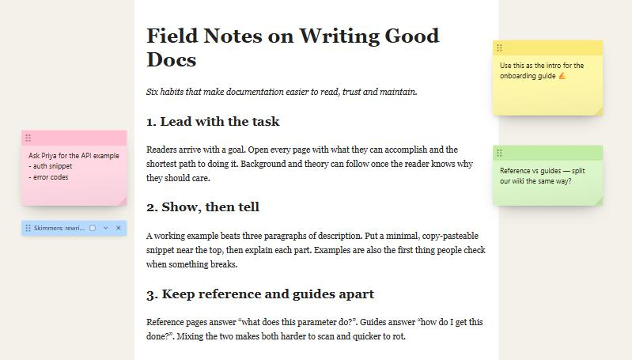
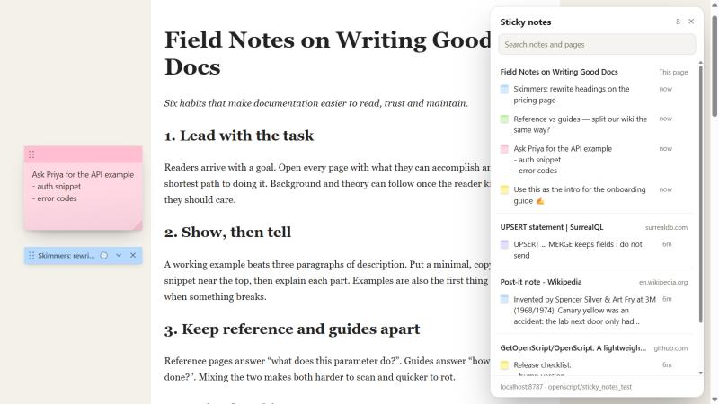

# StickyNotes.openscript

Classic sticky notes on any webpage, powered by [OpenScript](https://github.com/GetOpenScript/OpenScript). Every note is pinned to the exact page you left it on and synced to **your own SurrealDB**, so your notes follow you across browsers and devices without a third-party service.

## Scripts

### 1. Sticky Notes (`sticky-notes.os.js`)

Adds yellow (or pink, green, blue, purple, orange) notes to any page. Notes scroll with the page, staying beside the paragraph you attached them to.

#### Features
- **Popup buttons:** **Add sticky note**, **Hide/Show notes on this page**, and **All sticky notes**, right in the OpenScript popup.
- **Pinned to the exact URL:** Query strings are kept, so `?page=2` gets its own notes. Tracking parameters (`utm_*`, `fbclid`, `gclid`, …) and `#section` anchors are ignored so links don't split your notes. Hash routes such as `#/inbox` are kept.
- **Sticks to the page:** Notes live in document coordinates and scroll with the content. The horizontal position is anchored to the page's centre line, so a note in the margin stays beside centred content at any window width or on another monitor.
- **Drag, resize, collapse:** Drag by the top strip (the page auto-scrolls near the viewport edges), resize from the folded corner, and double-click the strip to collapse a note to a one-line label.
- **Autosave:** Saves 0.7 s after you stop typing, and immediately on blur, move, resize or colour change. A failed save shows **Not saved · retry** and retries automatically. Failed saves are also kept locally and replayed on the next page load, so closing a tab while offline loses nothing.
- **Undo delete:** Deleting a note shows a toast with **Undo**.
- **All notes panel:** Search every note, grouped by page with this page first. Click a note on another page to open it; the page scrolls to the note and highlights it.
- **Sync between tabs and devices:** Notes refresh when you return to a tab, without overwriting a note you're editing.
- **SPA aware:** Follows client-side navigation (YouTube, GitHub, Reddit, …) via the Navigation API.
- **Plays nicely with sites:**
  - The UI lives in a closed Shadow DOM, so page CSS can't restyle it.
  - Keystrokes inside a note never trigger site shortcuts (YouTube `k`, GitHub `s`, Gmail `c`, …).
  - Copy/paste blockers and focus traps can't interfere.
  - Notes are hidden when printing.
- **Light on the network:** A cached index of which URLs have notes (refreshed at most once a minute) means pages without notes never query the database.

#### Installation
1. Install [OpenScript](https://chromewebstore.google.com/detail/openscript/dkelmgdchndagjemmodhkphdikhpnfol) (requires version `1.0.6` or newer for popup buttons).
2. In the OpenScript popup, open **Secrets** and add:

   | Secret | Example | Required |
   | :--- | :--- | :--- |
   | `SURREAL_URL` | `https://surreal.example.com` (`wss://…/rpc` also works) | Yes |
   | `SURREAL_USER` | a root, namespace or database user | Yes |
   | `SURREAL_PASS` | that user's password | Yes |
   | `SURREAL_NS` | defaults to `openscript` | No |
   | `SURREAL_DB` | defaults to `sticky_notes` | No |

3. Click **New Script**, paste the contents of [`sticky-notes.os.js`](sticky-notes.os.js), save, and make sure it is enabled.
4. Reload any page, open the OpenScript popup and click **Add sticky note**.

#### Data
Notes are stored in the `sticky_note` table. On first write the script defines the table, `created`/`updated` timestamps and an index on `url`, so the user needs the Editor or Owner role on that database. If `SURREAL_NS`/`SURREAL_DB` don't exist yet, it needs root (or namespace) access to create them.

| Field | Description |
| :--- | :--- |
| `url` | Normalised page URL the note belongs to |
| `title` | Page title, shown in the All notes panel |
| `text` | Note contents |
| `x` | Left edge, in px from the page's horizontal centre line |
| `y` | Top edge, in px from the top of the document |
| `w`, `h` | Size in px |
| `color` | `yellow`, `pink`, `green`, `blue`, `purple` or `orange` |
| `collapsed` | Whether the note is collapsed to its title strip |
| `created`, `updated` | Set by SurrealDB |

Requests go straight from the browser to your `SURREAL_URL` through `OpenScript.fetch` (HTTP `/rpc` with Basic auth) and nowhere else. Values are sent as escaped SurrealQL literals rather than RPC variables. SurrealDB's JSON-RPC would otherwise turn text like `todo: buy milk` into the record link `todo:buy`.

#### Limitations
- Pages that scroll an inner container instead of the window (some web apps) keep notes fixed to the viewport.
- Positions are page coordinates. If a page's layout changes a lot, a note can drift from the text it annotated.
- User scripts don't run on `chrome://` pages or the Chrome Web Store.
